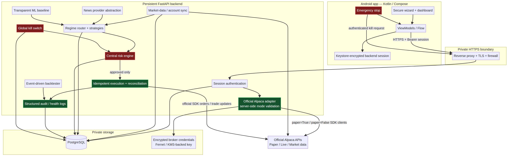

# Architecture

The Android app is deliberately **not** the trading engine. It presents verified account state, receives backend updates, retains only an encrypted short-lived backend session token, and exposes an emergency-stop control. This avoids treating Android background scheduling as reliable order-execution infrastructure.

The FastAPI service is the trust boundary. It validates a key pair against the official Alpaca SDK in both explicit paper and explicit live configurations. Exactly one successful account response determines the stored environment. The selected label from Android is only a mismatch check, never evidence. Paper and live connections are separate database records with separate encrypted credential ciphertext, audit records, and automation state.

A persistent worker is intended to obtain market/account updates, call the deterministic regime router and independent strategy modules, collect configured news context, optionally score a setup, and call the central risk engine. No strategy, model, or news provider receives an order-submission capability. The execution service creates an auditable order intent and calls Alpaca only after the risk result is `APPROVED`. It uses a deterministic client order ID and queries by that ID after an ambiguous timeout.

The diagram source is [architecture.mmd](architecture.mmd); render it with `manus-render-diagram docs/architecture.mmd docs/architecture.png`.
